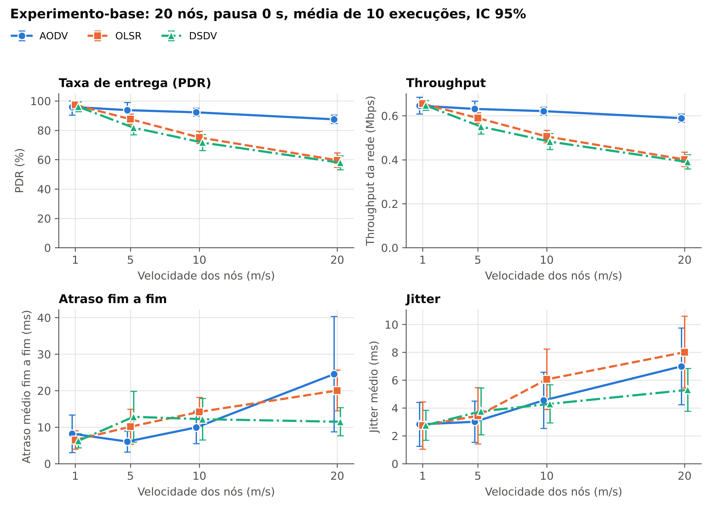
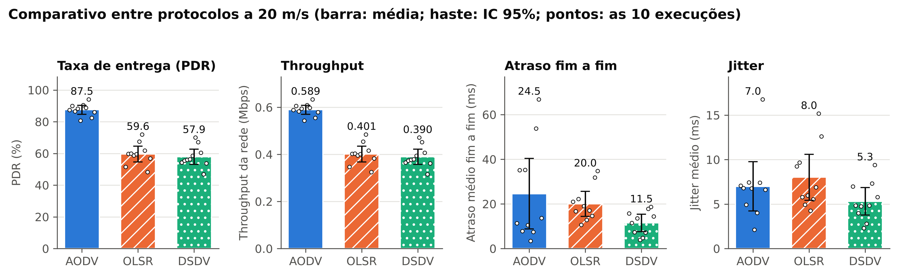
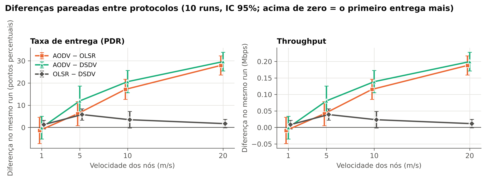
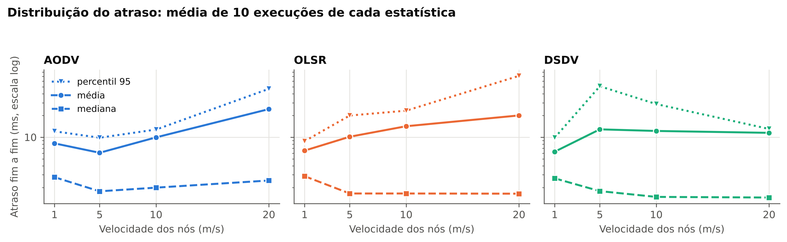
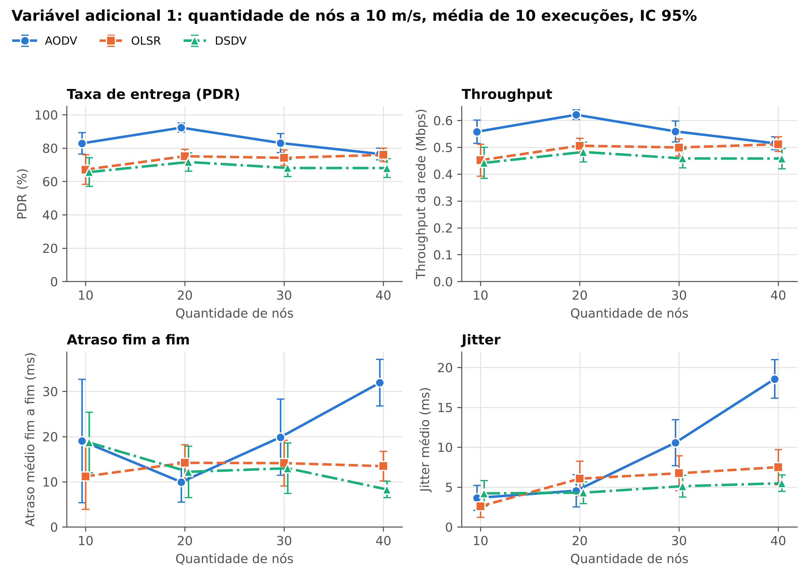
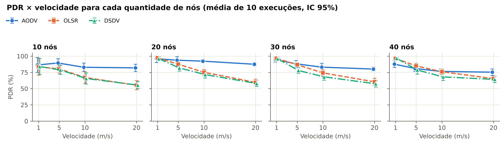
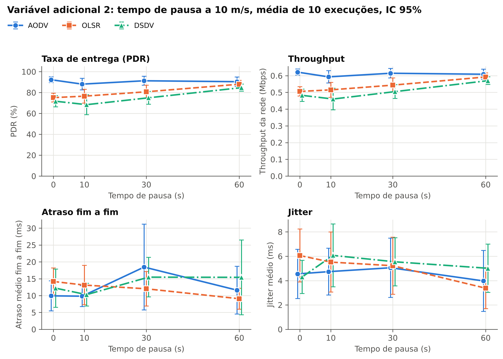
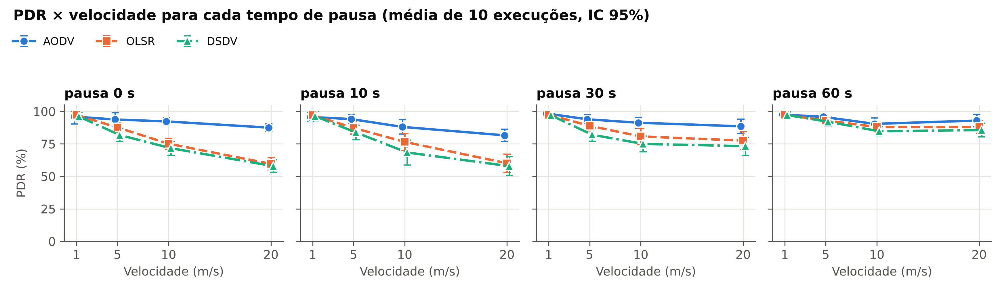

# Mobilidade e roteamento em MANET com ns-3: AODV, OLSR e DSDV

Trabalho final de Redes Móveis, Engenharia de Software, IFG Câmpus Inhumas, 2026/2.
Prof. Rogério Sousa e Silva.

**Grupo:** Gabriel Braga, Dante de Souza, Thays Marques e Luis Hernandez Penariol

Este repositório contém tudo o que é necessário para reproduzir o experimento do artigo:
o código da simulação, o script que roda o lote, os dados brutos de todas as execuções,
o script de análise e os gráficos.

## 1. O experimento em uma página

**Pergunta de pesquisa:** como diferentes níveis de mobilidade afetam o desempenho dos
protocolos AODV, OLSR e DSDV em uma rede móvel Ad Hoc?

| Item | Valor |
|---|---|
| Simulador | ns-3.48 |
| Tecnologia | IEEE 802.11b em modo Ad Hoc, 11 Mbps (DSSS) |
| Nós | 20 |
| Área | 500 × 500 m |
| Mobilidade | `RandomWaypointMobilityModel`, velocidade constante, pausa 0 s |
| Velocidades (variável independente) | 1, 5, 10 e 20 m/s |
| Protocolos (fator de comparação) | AODV, OLSR e DSDV, parâmetros padrão do ns-3 |
| Aplicação | UDP de taxa constante, 4 fluxos simultâneos |
| Pacotes | 1024 bytes de carga UDP, 20 pacotes/s por fluxo |
| Tempo de simulação | 120 s (tráfego de 20 s a 110 s) |
| Repetições | 10 por configuração (seed 12345, runs 1 a 10) |
| Métricas | throughput, PDR, atraso fim a fim (média, mediana e percentil 95) e jitter |
| Variável adicional 1 | quantidade de nós: 10, 20, 30 e 40 (pausa 0 s) |
| Variável adicional 2 | tempo de pausa do Random Waypoint: 0, 10, 30 e 60 s (20 nós) |

Total: 3 protocolos × 4 velocidades × 10 repetições = **120 execuções** na etapa 1, mais
**360 execuções** em cada variável adicional (etapas 2 e 3) e 120 execuções de apoio
(seção 8.5): 960 simulações.

**Versão 2 (outubro de 2026).** A primeira entrega usava 5 repetições. Com o prazo da
apresentação ampliado, o experimento foi refeito com 10 repetições, ganhou a segunda
variável adicional (tempo de pausa) e passou a registrar a mediana e o percentil 95 do
atraso (seção 8.7). Os runs 1 a 5 produzem exatamente os mesmos números da versão 1.

## 2. Estrutura do repositório

```
manet-ns3/
├── README.md
├── requirements.txt            dependências Python da análise
├── src/
│   └── manet-routing.cc        simulação (um único programa para os três protocolos)
├── scripts/
│   ├── run_batch.sh            executa o lote e grava um CSV por execução
│   └── analyze.py              validação, estatísticas e gráficos
├── data/
│   ├── raw/
│   │   ├── base/               etapa 1: 120 CSVs + batch.log
│   │   ├── extensao_nos/       etapa 2: 360 CSVs + batch.log
│   │   ├── extensao_pausa/     etapa 3: 360 CSVs + batch.log
│   │   └── apoio_arp_padrao/   apoio: 120 CSVs + batch.log
│   └── processed/              tabelas geradas por analyze.py
├── figures/                    gráficos em PNG (300 dpi) e PDF (vetorial)
└── article/                    artigo no modelo SBC
    ├── artigo.tex, artigo.pdf  fonte LaTeX e PDF
    ├── referencias.bib         referências
    ├── tabela_base.tex         tabela de resultados, gerada por analyze.py
    ├── figuras/                figuras do artigo, geradas por analyze.py
    └── sbc-template.sty, sbc.bst   modelo da SBC
```

## 3. Ambiente

Ambiente em que os dados deste repositório foram gerados:

| Componente | Versão |
|---|---|
| ns-3 | 3.48 (tag `ns-3.48`, commit `d2add90b`) |
| Sistema operacional | Ubuntu 24.04.5 LTS, x86_64 |
| Compilador | g++ 13.3.0 |
| CMake / Ninja | 3.28.3 / 1.11.1 |
| Python | 3.13 |
| numpy / pandas / matplotlib | 2.5.3 / 3.0.5 / 3.11.2 |

Requisitos mínimos do ns-3.48: g++ 11.1 ou superior, CMake 3.25 ou superior e
Python 3.10 ou superior.

## 4. Preparação e compilação

```bash
# 4.1 Dependências do sistema (Ubuntu/Debian)
sudo apt update
sudo apt install -y g++ cmake ninja-build python3 python3-pip git

# 4.2 Este repositório
git clone https://github.com/gabbragadev/manet-ns3.git
cd manet-ns3
pip install -r requirements.txt

# 4.3 ns-3.48
git clone --branch ns-3.48 --depth 1 https://gitlab.com/nsnam/ns-3-dev.git ~/ns-3
# espelho oficial, caso o GitLab esteja indisponível:
#   git clone --branch ns-3.48 --depth 1 https://github.com/nsnam/ns-3-dev-git.git ~/ns-3

# 4.4 Configuração e compilação (cerca de 30 minutos em 2 núcleos)
cd ~/ns-3
./ns3 configure -d optimized \
    --enable-modules "aodv;olsr;dsdv;wifi;internet;applications;mobility;flow-monitor"
./ns3 build
```

O perfil `optimized` só muda o tempo de execução. O perfil padrão (`./ns3 configure`
sem `-d`) também funciona, só é mais lento.

Em uma máquina sem `sudo`, nada precisa ser instalado no sistema: o ns-3 fica inteiro
dentro de `~/ns-3`. Se o CMake for antigo, `pip install --user cmake` resolve.

## 5. Execução

### 5.1 Um cenário

```bash
cp src/manet-routing.cc ~/ns-3/scratch/
cd ~/ns-3
./ns3 run "scratch/manet-routing --protocol=AODV --speed=10 --run=3 --simTime=120"
```

Saída esperada (resumida):

```
protocolo=AODV (ns3::aodv::RoutingProtocol) velocidade=10 m/s nos=20 fluxos=4 seed=12345 run=3
  fluxo 1 (no 0 -> no 19): gerados=1800 recebidos=... PDR=...% vazao=... Mbps atraso=... ms ...
  ...
  REDE: gerados=7200 recebidos=... PDR=...% vazao=... Mbps atraso=... ms jitter=... ms ...
```

Para gravar o CSV, acrescente `--csv=arquivo.csv`. Para ver todos os parâmetros:
`./ns3 run "scratch/manet-routing --PrintHelp"`.

### 5.2 Lote completo

A partir da raiz deste repositório:

```bash
NS3_DIR=~/ns-3 JOBS=2 scripts/run_batch.sh base    # etapa 1: 120 execuções
NS3_DIR=~/ns-3 JOBS=2 scripts/run_batch.sh nos     # etapa 2: 360 execuções
NS3_DIR=~/ns-3 JOBS=2 scripts/run_batch.sh pausa   # etapa 3: 360 execuções
NS3_DIR=~/ns-3 JOBS=2 scripts/run_batch.sh arp     # apoio: 120 execuções
# ou tudo de uma vez:
NS3_DIR=~/ns-3 JOBS=2 scripts/run_batch.sh tudo
```

O script copia `src/manet-routing.cc` para `scratch/` do ns-3, compila e executa cada
combinação. `JOBS` é o número de simulações em paralelo. Execuções que já têm CSV são
puladas; `FORCE=1` refaz tudo; `RUNS=5` roda menos repetições. Tempo medido com
`JOBS=2`: cerca de 8 minutos para a etapa 1, 55 para a etapa 2 (redes de 40 nós são as
mais lentas) e 25 para a etapa 3.

### 5.3 Análise

```bash
python3 scripts/analyze.py
```

Gera o relatório de validação, as tabelas em `data/processed/` e os gráficos em
`figures/`. Opções: `--compare-speed` (velocidade do gráfico comparativo, padrão 20) e
`--ext-speed` (velocidade dos painéis das variáveis adicionais, padrão 10) e `--runs`
(repetições esperadas por configuração, padrão 10).

## 6. Parâmetros da simulação

Todos são argumentos de linha de comando de `manet-routing`. Os valores padrão são os
do experimento-base.

| Argumento | Significado | Unidade | Padrão |
|---|---|---|---|
| `--protocol` | protocolo de roteamento: `AODV`, `OLSR` ou `DSDV` | | `AODV` |
| `--speed` | velocidade dos nós (constante) | m/s | 10 |
| `--run` | número da repetição (`RngRun`) | | 1 |
| `--seed` | seed mestre do gerador pseudoaleatório | | 12345 |
| `--simTime` | tempo de simulação | s | 120 |
| `--nodes` | quantidade de nós | | 20 |
| `--flows` | fluxos UDP simultâneos | | 4 |
| `--area` | lado da área quadrada | m | 500 |
| `--pause` | tempo de pausa do Random Waypoint | s | 0 |
| `--pktSize` | carga UDP por pacote | bytes | 1024 |
| `--packetRate` | pacotes por segundo em cada fluxo | pacotes/s | 20 |
| `--txPower` | potência de transmissão | dBm | 4 |
| `--appStart` | início do tráfego | s | 20 |
| `--appStop` | fim do tráfego (negativo: `simTime` − 10) | s | 110 |
| `--arpDeadTimeout` | bloqueio do ARP após falha de resolução (seção 8.5) | s | 1 |
| `--lineSpacing` | modo de validação: nós parados em linha com este espaçamento | m | 0 (desligado) |
| `--csv` | arquivo CSV de saída (uma linha por fluxo) | | vazio |
| `--mobilityTrace` | CSV com a posição de todos os nós a cada 1 s | | vazio |
| `--flowmonXml` | XML bruto do FlowMonitor | | vazio |
| `--quiet` | não imprime o resumo no terminal | | `false` |

## 7. Aleatoriedade e repetições

- **Seed mestre:** 12345, fixa em todas as execuções (`RngSeedManager::SetSeed`).
- **Repetições:** `--run` de 1 a 10 (`RngSeedManager::SetRun`). Cada run usa subfluxos
  independentes do gerador, que é o método recomendado pelo manual do ns-3.
- **Mesma mobilidade para os três protocolos:** os streams aleatórios da posição inicial,
  dos destinos do Random Waypoint e do instante de início dos fluxos são fixados no código.
  Para a mesma combinação de run, velocidade e número de nós, as trajetórias são idênticas
  com AODV, OLSR e DSDV (conferido na seção 9). A diferença entre protocolos não vem de
  topologias diferentes.
- **Determinismo:** repetir um comando produz o mesmo CSV, byte a byte, na mesma máquina.
  Em outro processador ou compilador podem aparecer diferenças numéricas pequenas, porque
  o perfil `optimized` usa instruções nativas da CPU.
- Seed e run ficam registrados em cada linha dos CSVs e no `batch.log`.

## 8. Decisões do cenário e justificativas

O enunciado fixa nós, área, mobilidade, velocidades, aplicação, tempo, tamanho de pacote,
fluxos e protocolos. O que ele não fixa foi decidido como descrito abaixo.

### 8.1 Camada física e alcance de rádio

- IEEE 802.11b, 11 Mbps (`DsssRate11Mbps`) para dados, controle e broadcast
  (`ConstantRateWifiManager` e `NonUnicastMode`). Com a mesma taxa em tudo, as mensagens
  de roteamento têm o mesmo alcance dos dados.
- Propagação em espaço livre (`FriisPropagationLossModel`) em 2,412 GHz.
- **Potência de transmissão de 4 dBm, que dá alcance de 197 m.** Com a potência padrão do
  ns-3 (16 dBm) o alcance passa de 700 m, maior que a diagonal da área (707 m): todos os
  nós se alcançariam em um salto e o protocolo de roteamento não teria o que fazer. Com
  197 m as rotas têm vários saltos e a rede fica conectada na maior parte do tempo.
  O alcance foi medido (seção 9) e confere com a conta: o Wi-Fi do ns-3 só detecta quadros
  acima de −82 dBm, e a perda de Friis em 2,412 GHz chega a 86 dB em 197,5 m.

### 8.2 Tráfego

- `UdpClient` → `UdpServer`, 1024 bytes de carga a cada 50 ms (20 pacotes/s), o que dá
  163,84 kbps por fluxo na aplicação e 168,32 kbps na camada IP (1052 bytes por pacote
  com os cabeçalhos UDP e IP). Carga oferecida total: 0,673 Mbps na camada IP. É uma carga
  baixa para um canal de 11 Mbps, de propósito: as perdas vêm de rotas quebradas, não de
  congestionamento.
- Fluxo *i*: nó *i* → nó *N − 1 − i* (0→19, 1→18, 2→17, 3→16 com 20 nós). Origens e
  destinos não se repetem e são os mesmos para todos os protocolos.
- Cada fluxo começa com um atraso sorteado entre 0 e 1 s, para as fontes não transmitirem
  em fase.

### 8.3 Linha do tempo e duração útil do throughput

- 0 a 20 s: aquecimento, sem tráfego. Dá tempo para OLSR e DSDV montarem as tabelas.
- 20 a 110 s: tráfego. Cada fluxo gera exatamente 1800 pacotes.
- 110 a 120 s: sem tráfego novo, para os pacotes em trânsito chegarem.

**Duração útil = 90 s** (`appStop − appStart`), igual para todos os fluxos, protocolos e
repetições. O throughput não usa `timeLastRxPacket − timeFirstTxPacket` porque esse
intervalo encolhe quando um fluxo para de receber e inflaria a vazão justamente nos piores
casos.

### 8.4 Definição das métricas

| Métrica | Cálculo por fluxo | Unidade |
|---|---|---|
| Throughput | `rxBytes × 8 / 90 s` (`rxBytes` do FlowMonitor, inclui cabeçalhos IP e UDP) | Mbps |
| PDR | `rxPackets / appTxPackets × 100` | % |
| Atraso médio | `delaySum / rxPackets` | ms |
| Jitter médio | `jitterSum / (rxPackets − 1)` | ms |
| Perdidos | `appTxPackets − rxPackets` | pacotes |

Métricas da rede em uma execução: throughput é a soma dos 4 fluxos; PDR, atraso e jitter
são calculados sobre os totais (soma dos recebidos, soma dos atrasos etc.), o que equivale
a uma média ponderada pelo número de pacotes.

**Por que o PDR usa os pacotes gerados pela aplicação e não o `txPackets` do FlowMonitor.**
Quando o OLSR não tem rota, o socket UDP recusa o envio e o pacote nem chega à camada IP,
onde o FlowMonitor mede. Esses pacotes sumiriam do denominador e o PDR do OLSR ficaria
artificialmente alto. AODV e DSDV não têm esse efeito porque guardam o pacote em fila
enquanto procuram rota. Teste que mostra a diferença: 2 nós a 300 m (fora de alcance),
1800 pacotes gerados.

| Protocolo | Gerados pela aplicação | `txPackets` do FlowMonitor | Recebidos |
|---|---|---|---|
| AODV | 1800 | 1800 | 0 |
| OLSR | 1800 | **0** | 0 |
| DSDV | 1800 | 1800 | 0 |

O contador da aplicação vem do trace `Tx` do `UdpClient`. As duas contagens ficam no CSV
(`appTxPackets` e `ipTxPackets`).

### 8.5 Ajuste do ARP

Único parâmetro fora do padrão do ns-3 além da camada física:
`ns3::ArpCache::DeadTimeout` passou de 100 s para **1 s**.

No padrão, um vizinho que não responde aos pedidos ARP (um envio e três repetições, com
1 s entre elas) fica marcado como morto por 100 s.
Durante esse tempo todo pacote encaminhado a ele é descartado em silêncio, sem aviso ao
protocolo de roteamento. Em uma simulação de 120 s com nós móveis, uma falha momentânea
vira um bloqueio que dura quase a execução inteira. O efeito apareceu em um teste
preliminar com AODV a 1 m/s: a resolução ARP de um nó para um vizinho falhou logo no
início do tráfego (pedidos em t ≈ 20 a 23 s, sem resposta). Aos 48 s o AODV passou a usar
esse vizinho como próximo salto, a 184 m e dentro do alcance, e o nó descartou todos os
pacotes do fluxo (20 por segundo) durante 46 s, porque a entrada ARP continuava bloqueada.
O OLSR, no mesmo cenário, entregou 99,9%. Esse comportamento é do modelo de ARP e não dos
protocolos avaliados.

Para medir o efeito, a etapa 1 inteira foi repetida com o valor padrão
(`data/raw/apoio_arp_padrao/`). PDR médio em % (tabela completa em
`data/processed/resumo.md`):

| Velocidade | AODV 1 s / 100 s | OLSR 1 s / 100 s | DSDV 1 s / 100 s |
|---|---|---|---|
| 1 m/s | 96,0 / 92,2 | 97,3 / 97,3 | 96,0 / 95,4 |
| 5 m/s | 93,8 / 87,9 | 87,6 / 85,7 | 81,8 / 79,6 |
| 10 m/s | 92,3 / 79,4 | 75,1 / 69,3 | 71,7 / 64,2 |
| 20 m/s | 87,5 / 72,6 | 59,6 / 55,0 | 57,9 / 52,5 |

O ajuste melhora os três protocolos, mais o AODV, e reduz a variação entre execuções.
A ordem entre os protocolos é a mesma com ou sem o ajuste.

### 8.6 Protocolos de roteamento

Parâmetros padrão do ns-3.48, sem ajuste. Os que mais pesam na interpretação:

| Protocolo | Tipo | Parâmetros padrão relevantes |
|---|---|---|
| AODV | reativo | HELLO a cada 1 s, 2 perdas toleradas, rota ativa por 3 s |
| OLSR | proativo, estado de enlace | HELLO a cada 2 s, TC a cada 5 s |
| DSDV | proativo, vetor de distância | atualização periódica a cada 15 s, assentamento de 5 s |

### 8.7 Distribuição do atraso: média, mediana e percentil 95

A média do atraso é dominada por poucos pacotes. Quando uma rota quebra, o AODV e o
DSDV guardam os pacotes numa fila enquanto procuram outra rota (até 30 s no AODV), e os
que chegam depois disso trazem segundos de atraso. Exemplo, AODV com 10 nós a 20 m/s,
run 4: **mediana de 1,25 ms, média de 179 ms e percentil 95 de 1,1 s**. Por isso a média
do atraso e o jitter variam tanto de uma execução para outra.

Desde a versão 2 o programa registra também a mediana e o percentil 95 do atraso. O
FlowMonitor guarda um histograma do atraso de cada fluxo; a largura dos bins foi ajustada
para 0,1 ms (`DelayBinWidth`), e o programa lê os percentis desse histograma. Mediana =
atraso típico de um pacote; percentil 95 = atraso dos 5% piores; média = o que o enunciado
pede, sensível à cauda.

### 8.8 Comparação pareada entre protocolos

Em cada run os três protocolos veem exatamente o mesmo movimento e o mesmo tráfego
(seção 7). Grande parte da variação entre runs vem da topologia sorteada (uma execução
com origem e destino longe um do outro piora os três protocolos juntos). A diferença
**AODV − OLSR no mesmo run** cancela esse efeito, e o intervalo de confiança da diferença
fica bem mais estreito que o das médias separadas. `analyze.py` calcula essa diferença
para os três pares, por configuração, com IC 95% (t de Student, 9 graus de liberdade), em
`data/processed/diferencas_pareadas.csv`. Uma diferença é tratada como real quando o
intervalo não inclui zero.

## 9. Validação do cenário

Feita antes do lote, como pedem os slides. Todos os comandos usam o próprio
`manet-routing`.

| O que foi conferido | Como | Resultado |
|---|---|---|
| Protocolo instalado | o programa lê o `TypeId` do roteamento no nó 0 e grava no CSV | `ns3::aodv::`, `ns3::olsr::` e `ns3::dsdv::RoutingProtocol`, conforme pedido |
| Alcance do rádio | 2 nós parados, `--nodes=2 --flows=1 --lineSpacing=D` | PDR 100% até 197 m e 0% a partir de 198 m |
| Roteamento em múltiplos saltos | 5 nós em linha a 150 m, `--nodes=5 --flows=1 --lineSpacing=150` | PDR de 99,6% a 100% e 4,00 saltos nos três protocolos |
| Mesma mobilidade entre protocolos | `--mobilityTrace` nos três protocolos, mesmo run | arquivos de posição idênticos (mesmo MD5); runs diferentes dão trajetórias diferentes |
| Determinismo | mesmo comando duas vezes | CSVs idênticos |
| Consistência dos dados | `scripts/analyze.py` | `data/processed/validacao.txt`, 0 problemas |

Exemplo:

```bash
cd ~/ns-3
./ns3 run "scratch/manet-routing --protocol=OLSR --nodes=5 --flows=1 --lineSpacing=150"
```

## 10. Saídas

### 10.1 Dados brutos

Um CSV por execução, com uma linha por fluxo:
`data/raw/<etapa>/manet_<PROTOCOLO>_v<velocidade>_n<nós>_p<pausa>_run<run>.csv`.
O `batch.log` de cada etapa registra data e hora, versão do ns-3, protocolo, velocidade,
nós, pausa, seed, run, situação e duração de cada execução.

| Coluna | Significado |
|---|---|
| `protocol`, `speed`, `nodes`, `flows`, `areaSide`, `pause`, `pktSize`, `packetRate`, `txPowerDbm`, `arpDeadTimeout`, `simTime`, `appStart`, `appStop` | parâmetros da execução |
| `seed`, `run` | seed mestre e número da repetição |
| `flowId`, `srcNode`, `dstNode`, `dstPort` | identificação do fluxo |
| `appTxPackets` | pacotes gerados pela aplicação |
| `ipTxPackets` | pacotes vistos pelo FlowMonitor na camada IP da origem |
| `rxPackets`, `lostPackets`, `rxBytes` | recebidos, perdidos e bytes recebidos |
| `throughputMbps`, `pdrPct`, `delayMs`, `jitterMs` | métricas do fluxo (seção 8.4) |
| `timesForwarded`, `avgHops` | encaminhamentos e saltos por pacote entregue (1 + encaminhamentos / recebidos) |
| `timeFirstTxS`, `timeLastRxS` | instantes da primeira transmissão e da última recepção |
| `runCtrlTxPackets`, `runCtrlTxBytes` | mensagens de controle do roteamento transmitidas por todos os nós na execução (valor repetido nas linhas da mesma execução) |
| `delayP50Ms`, `delayP95Ms` | mediana e percentil 95 do atraso dos pacotes do fluxo (seção 8.7) |
| `runDelayP50Ms`, `runDelayP95Ms` | o mesmo para todos os pacotes de dados da execução (valor repetido nas linhas da mesma execução) |
| `routingTypeId` | protocolo realmente instalado |

`delayMs` e `jitterMs` ficam como `nan` quando o fluxo não recebeu pacotes suficientes
para o cálculo.

### 10.2 Dados processados (`data/processed/`)

| Arquivo | Conteúdo |
|---|---|
| `validacao.txt` | relatório de validação dos dados brutos |
| `por_fluxo.csv` | todas as linhas brutas reunidas |
| `por_execucao.csv` | métricas da rede em cada execução |
| `estatisticas.csv` | média, mediana, mínimo, máximo, desvio-padrão amostral e IC 95% por configuração |
| `diferencas_pareadas.csv` | diferença entre cada par de protocolos no mesmo run, com IC 95% (seção 8.8) |
| `resumo.md` | as mesmas estatísticas em tabelas legíveis |
| `apoio_arp_padrao_estatisticas.csv` | estatísticas da etapa de apoio (seção 8.5) |

O intervalo de confiança de 95% usa a distribuição t de Student com 9 graus de liberdade
(t = 2,262 para 10 repetições).

### 10.3 Gráficos (`figures/`)

| Arquivo | Gráfico |
|---|---|
| `fig1_pdr_x_velocidade` | PDR × velocidade |
| `fig2_throughput_x_velocidade` | Throughput × velocidade |
| `fig3_delay_x_velocidade` | Atraso × velocidade |
| `fig4_jitter_x_velocidade` | Jitter × velocidade |
| `fig5_comparativo_v20` | comparativo agregado entre os protocolos a 20 m/s |
| `fig6_extensao_nos_v10` | variável adicional 1: as 4 métricas × quantidade de nós a 10 m/s |
| `fig7_extensao_nos_pdr_x_velocidade` | variável adicional 1: PDR × velocidade para cada quantidade de nós |
| `fig8_extensao_pausa_v10` | variável adicional 2: as 4 métricas × tempo de pausa a 10 m/s |
| `fig9_extensao_pausa_pdr_x_velocidade` | variável adicional 2: PDR × velocidade para cada tempo de pausa |
| `fig10_atraso_media_mediana_p95` | média, mediana e percentil 95 do atraso × velocidade (escala log) |
| `fig11_diferencas_pareadas` | diferenças pareadas de PDR e throughput entre protocolos |
| `painel_base` | figuras 1 a 4 em um único painel (economiza espaço no artigo) |
| `apoio_controle_x_velocidade` | tráfego de controle do roteamento × velocidade |
| `apoio_saltos_x_velocidade` | saltos por pacote entregue × velocidade |

Todos têm uma série por protocolo, média de 10 execuções e barras de erro com IC 95%,
truncadas nos limites físicos da métrica (0 e, no PDR, 100%).

### 10.4 Artigo (`article/`)

`analyze.py` também grava as quatro figuras do artigo (`article/figuras/`, no tamanho final
da página e sem título embutido) e as linhas da tabela de resultados
(`article/tabela_base.tex`). Assim, todo número e todo gráfico do artigo sai dos CSVs
brutos pelo mesmo script. Para compilar:

```bash
cd article
pdflatex artigo && bibtex artigo && pdflatex artigo && pdflatex artigo
```

No Overleaf, basta enviar a pasta `article/` inteira e compilar `artigo.tex`.

## 11. Resultados da etapa 1 (experimento-base)

Média ± IC 95% de 10 execuções, 20 nós, pausa 0 s. Mediana, mínimo, máximo e
desvio-padrão de cada célula estão em `data/processed/resumo.md` e
`data/processed/estatisticas.csv`.

**PDR (%)**

| Velocidade (m/s) | AODV | OLSR | DSDV |
|---|---|---|---|
| 1 | 96,0 ± 5,7 | 97,3 ± 2,5 | 96,0 ± 3,3 |
| 5 | 93,8 ± 5,2 | 87,6 ± 3,6 | 81,8 ± 4,9 |
| 10 | 92,3 ± 2,7 | 75,1 ± 4,2 | 71,7 ± 5,4 |
| 20 | 87,5 ± 2,8 | 59,6 ± 4,9 | 57,9 ± 4,8 |

**Diferença pareada de PDR no mesmo run (pontos percentuais; * = intervalo não inclui zero)**

| Velocidade (m/s) | AODV − OLSR | AODV − DSDV | OLSR − DSDV |
|---|---|---|---|
| 1 | -1,4 ± 5,9 | -0,1 ± 5,1 | 1,3 ± 1,9 |
| 5 | 6,2 ± 5,4 * | 12,0 ± 6,6 * | 5,8 ± 2,5 * |
| 10 | 17,1 ± 4,6 * | 20,6 ± 5,0 * | 3,5 ± 3,8 |
| 20 | 27,9 ± 4,3 * | 29,6 ± 4,2 * | 1,7 ± 1,9 |

**Throughput da rede (Mbps)**, carga oferecida de 0,673 Mbps

| Velocidade (m/s) | AODV | OLSR | DSDV |
|---|---|---|---|
| 1 | 0,646 ± 0,038 | 0,655 ± 0,017 | 0,647 ± 0,022 |
| 5 | 0,631 ± 0,035 | 0,590 ± 0,024 | 0,551 ± 0,033 |
| 10 | 0,621 ± 0,018 | 0,506 ± 0,028 | 0,482 ± 0,037 |
| 20 | 0,589 ± 0,019 | 0,401 ± 0,033 | 0,390 ± 0,032 |

**Atraso médio fim a fim (ms)**

| Velocidade (m/s) | AODV | OLSR | DSDV |
|---|---|---|---|
| 1 | 8,2 ± 5,1 | 6,5 ± 2,5 | 6,3 ± 1,9 |
| 5 | 6,1 ± 2,9 | 10,1 ± 4,8 | 12,8 ± 7,0 |
| 10 | 9,9 ± 4,4 | 14,2 ± 4,0 | 12,2 ± 5,7 |
| 20 | 24,5 ± 15,8 | 20,0 ± 5,6 | 11,5 ± 3,9 |

**Mediana do atraso (ms)**

| Velocidade (m/s) | AODV | OLSR | DSDV |
|---|---|---|---|
| 1 | 2,78 ± 1,42 | 2,87 ± 1,38 | 2,68 ± 1,30 |
| 5 | 1,77 ± 0,83 | 1,65 ± 0,56 | 1,78 ± 0,85 |
| 10 | 1,99 ± 1,08 | 1,65 ± 0,62 | 1,48 ± 0,52 |
| 20 | 2,50 ± 1,40 | 1,64 ± 0,77 | 1,45 ± 0,66 |

**Jitter médio (ms)**

| Velocidade (m/s) | AODV | OLSR | DSDV |
|---|---|---|---|
| 1 | 2,8 ± 1,6 | 2,7 ± 1,7 | 2,8 ± 1,1 |
| 5 | 3,0 ± 1,5 | 3,4 ± 2,0 | 3,8 ± 1,7 |
| 10 | 4,5 ± 2,0 | 6,1 ± 2,2 | 4,3 ± 1,4 |
| 20 | 7,0 ± 2,8 | 8,0 ± 2,6 | 5,3 ± 1,5 |









O que os dados mostram:

- **A 1 m/s os três protocolos empatam** (PDR de 96% a 97%; as diferenças pareadas
  incluem zero).
- **O PDR cai com a velocidade nos três, em intensidades muito diferentes.** De 1 para
  20 m/s o AODV perde 8,5 pontos percentuais; OLSR e DSDV perdem 37,7 e 38,2. No mesmo run,
  o AODV entrega 27,9 ± 4,3 p.p. a mais que o OLSR a 20 m/s. Entre OLSR e DSDV só há
  diferença significativa a 5 m/s.
- **O throughput acompanha o PDR**, como esperado em tráfego UDP de taxa constante.
- **Não há ruptura brusca.** Nos proativos a queda é mais rápida até 10 m/s (2 a 3,6 p.p.
  por m/s) e mais lenta entre 10 e 20 m/s (cerca de 1,5 p.p. por m/s).
- **A média do atraso cresce, a mediana não.** A média do AODV vai de 8,2 para 24,5 ms e a
  do OLSR de 6,5 para 20,0 ms, mas a mediana fica entre 1,5 e 3 ms em todos os casos. A
  média é puxada pelos pacotes que esperam numa fila enquanto o protocolo procura outra
  rota (seção 8.7). Isso explica a variação grande da média e do jitter entre execuções.
- **Dados de apoio:** o tráfego de controle do AODV quase dobra de 1 para 20 m/s (11,4 para
  22,0 kbps), enquanto o de OLSR e DSDV cresce pouco (11,7 para 15,2 e 12,5 para 13,8 kbps).
  Os pacotes que OLSR e DSDV entregam a 20 m/s percorrem menos saltos (1,42 e 1,29, contra
  1,70 no AODV). Isso é compatível com o AODV refazendo rotas assim que elas quebram e com
  os proativos usando rotas velhas até a próxima atualização periódica.

**Condição escolhida para o comparativo agregado (figura 5): 20 m/s.** É o nível de maior
mobilidade e onde a diferença entre os protocolos é maior em relação à variação entre
execuções.

## 12. Resultados da etapa 2 (variável adicional 1: quantidade de nós)

**Por que essa variável:** com a área fixa em 500 × 500 m, a quantidade de nós define a
densidade da rede, que atua nos dois sentidos. Mais nós dão mais caminhos alternativos
quando um enlace quebra, mas também mais mensagens de controle e mais disputa pelo canal.
Foram usados 10, 20, 30 e 40 nós, com pausa 0 s. O ponto de 20 nós é a própria etapa 1.

**PDR (%) a 20 m/s**

| Nós | AODV | OLSR | DSDV |
|---|---|---|---|
| 10 | 82,0 ± 5,7 | 55,2 ± 7,0 | 55,4 ± 5,6 |
| 20 | 87,5 ± 2,8 | 59,6 ± 4,9 | 57,9 ± 4,8 |
| 30 | 80,1 ± 2,9 | 60,4 ± 5,6 | 57,4 ± 5,2 |
| 40 | 75,3 ± 4,9 | 65,4 ± 3,9 | 64,2 ± 5,0 |

**PDR (%) a 1 m/s**

| Nós | AODV | OLSR | DSDV |
|---|---|---|---|
| 10 | 86,4 ± 11,7 | 83,6 ± 12,9 | 84,0 ± 12,3 |
| 20 | 96,0 ± 5,7 | 97,3 ± 2,5 | 96,0 ± 3,3 |
| 30 | 94,6 ± 3,8 | 96,5 ± 2,5 | 95,9 ± 2,7 |
| 40 | 87,7 ± 5,2 | 96,3 ± 1,8 | 96,6 ± 2,0 |

**Tráfego de controle (kbps) a 10 m/s**

| Nós | AODV | OLSR | DSDV |
|---|---|---|---|
| 10 | 5,9 ± 0,4 | 4,5 ± 0,1 | 3,0 ± 0,1 |
| 20 | 15,5 ± 2,0 | 14,4 ± 0,1 | 13,7 ± 0,1 |
| 30 | 51,3 ± 5,7 | 28,6 ± 0,3 | 31,6 ± 0,2 |
| 40 | 103,4 ± 7,9 | 48,0 ± 0,7 | 57,3 ± 0,3 |





O que os dados mostram:

- **A queda de OLSR e DSDV com a velocidade aparece em todas as densidades.**
- **A densidade reduz a vantagem do AODV.** A 20 m/s, de 20 para 40 nós, o AODV cai de
  87,5% para 75,3% e o OLSR sobe de 59,6% para 65,4%.
- **Em rede densa e quase parada a ordem se inverte:** a 1 m/s com 40 nós, o AODV entrega
  87,7% e os proativos acima de 96% (diferença pareada de cerca de −9 p.p., significativa).
- **O custo do AODV cresce muito mais rápido com a densidade:** a 10 m/s o controle vai de
  15,5 kbps com 20 nós para 103 kbps com 40, contra 48 kbps do OLSR e 57 kbps do DSDV. O
  jitter do AODV acompanha (18,6 ms com 40 nós).
- **Com 10 nós a rede é esparsa:** o intervalo de confiança passa de ±12 p.p. a 1 m/s,
  porque há pares sem caminho durante boa parte da simulação (3 fluxos, em 3.360, não
  receberam nenhum pacote). Esse ponto mede mais a conectividade do que o roteamento.

## 13. Resultados da etapa 3 (variável adicional 2: tempo de pausa)

**Por que essa variável:** no Random Waypoint, cada nó para no destino pelo tempo de pausa
antes de seguir. Com pausa maior, os nós passam mais tempo parados e a mobilidade efetiva
cai sem mudar a velocidade. É o par clássico da velocidade nos estudos de referência
(Broch et al. 1998). Foram usados 0, 10, 30 e 60 s, com 20 nós. O ponto de 0 s é a etapa 1.

**PDR (%) a 20 m/s**

| Pausa (s) | AODV | OLSR | DSDV |
|---|---|---|---|
| 0 | 87,5 ± 2,8 | 59,6 ± 4,9 | 57,9 ± 4,8 |
| 10 | 81,6 ± 4,8 | 60,1 ± 7,0 | 57,8 ± 7,2 |
| 30 | 88,5 ± 5,5 | 77,5 ± 6,7 | 73,2 ± 7,0 |
| 60 | 92,9 ± 4,9 | 88,0 ± 4,9 | 85,6 ± 5,4 |

**PDR (%) a 10 m/s**

| Pausa (s) | AODV | OLSR | DSDV |
|---|---|---|---|
| 0 | 92,3 ± 2,7 | 75,1 ± 4,2 | 71,7 ± 5,4 |
| 10 | 88,0 ± 5,5 | 76,5 ± 6,6 | 68,4 ± 9,6 |
| 30 | 91,3 ± 4,2 | 80,7 ± 6,3 | 75,0 ± 6,1 |
| 60 | 90,4 ± 4,5 | 88,0 ± 3,6 | 84,7 ± 3,4 |





O que os dados mostram:

- **A pausa confirma que o fator é a mobilidade efetiva.** A 20 m/s, de 0 para 60 s de
  pausa, OLSR e DSDV sobem de 59,6% e 57,9% para 88,0% e 85,6%, e o AODV de 87,5% para
  92,9%. A diferença pareada AODV − OLSR cai de 27,9 para 4,9 p.p.
- **Pausa de 10 s quase não muda o quadro;** o efeito aparece a partir de 30 s.
- **O controle do AODV cai quase pela metade com a pausa** (a 20 m/s, de 22,0 para
  11,9 kbps), bem mais que o do OLSR (15,2 para 11,8) e o do DSDV (13,8 para 12,1): o custo
  do AODV acompanha as quebras de rota.

## 14. Limitações

- Dez repetições ainda deixam intervalos largos na média do atraso e no jitter, que são
  dominados por poucos pacotes muito atrasados (seção 8.7). Diferenças menores que as
  barras de erro não devem ser tratadas como diferenças reais.
- Atraso e jitter só consideram pacotes entregues. Um protocolo que perde os pacotes das
  rotas mais longas pode parecer mais rápido por isso.
- No modelo Wi-Fi usado, o alcance de detecção de portadora é igual ao alcance de
  recepção (197 m), o que favorece o problema do terminal oculto mais do que em placas
  reais.
- A propagação em espaço livre dá um alcance em forma de disco perfeito, sem
  desvanecimento nem obstáculos.
- O Random Waypoint concentra os nós no centro da área ao longo do tempo, e esse efeito
  cresce com a velocidade.
- Os resultados valem para os parâmetros padrão dos protocolos no ns-3.48 e para este
  cenário. Não sustentam afirmações gerais do tipo "o protocolo X é o melhor".

## 15. Rastreabilidade

Versão do repositório correspondente ao artigo entregue: commit `PREENCHER`
(ou tag `entrega-artigo`).

## 16. Referências

- ns-3 Tutorial: https://www.nsnam.org/docs/tutorial/html/
- ns-3 Manual, Random Variables: https://www.nsnam.org/docs/manual/html/random-variables.html
- ns-3 Model Library, AODV: https://www.nsnam.org/docs/models/html/aodv.html
- ns-3 Model Library, OLSR: https://www.nsnam.org/docs/models/html/olsr.html
- ns-3 Model Library, DSDV: https://www.nsnam.org/docs/models/html/dsdv.html
- ns-3 Model Library, Flow Monitor: https://www.nsnam.org/docs/models/html/flow-monitor.html
- C. Perkins, E. Belding-Royer, S. Das. RFC 3561: Ad hoc On-Demand Distance Vector (AODV) Routing, 2003.
- T. Clausen, P. Jacquet. RFC 3626: Optimized Link State Routing Protocol (OLSR), 2003.
- C. Perkins, P. Bhagwat. Highly Dynamic Destination-Sequenced Distance-Vector Routing (DSDV) for Mobile Computers. ACM SIGCOMM, 1994.
